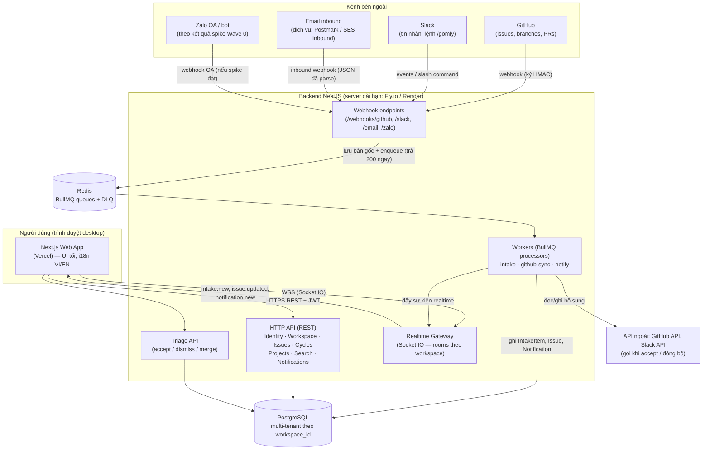
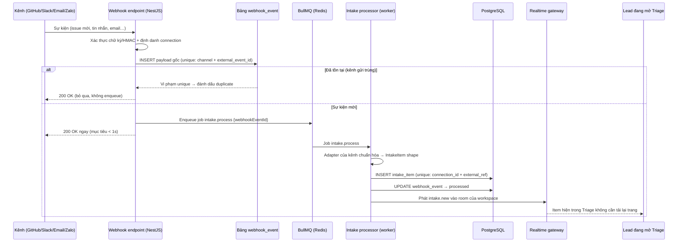

# Kiến trúc kỹ thuật — Gomly (MVP)

> Tài liệu thiết kế kiến trúc cho MVP của Gomly, suy ra trực tiếp từ PRD v1.2 (mô hình dữ liệu 10 thực thể, 31 user stories, mục 11 — stack ĐÃ CHỐT).
> Gomly: gom mọi yêu cầu từ Zalo, Slack, email và GitHub về một Triage duy nhất, biến thành issue và chạy theo cycle.
> Khẩu hiệu: "Mọi việc, về một mối".
>
> **Nguyên tắc xuyên suốt:** mọi quyết định trong tài liệu này phục vụ 3 lời hứa của PRD — (1) không mất yêu cầu đầu vào nào, (2) không lộ dữ liệu chéo workspace, (3) thao tác cho cảm giác tức thì. Nguồn lực solo ngoài giờ là ràng buộc cứng: ưu tiên giải pháp ít phải vận hành nhất mà vẫn giữ được 3 lời hứa trên.

---

## 0. Ràng buộc đã khóa (từ PRD mục 11 — không mở lại)

| Lớp | Đã chốt |
|---|---|
| Frontend | Next.js (App Router), giao diện tối, i18n VI/EN bằng khóa chuỗi, deploy **Vercel** |
| Backend | NestJS (TypeScript), module hóa theo miền, deploy **server dài hạn** (Fly.io/Render/Railway/VPS) — **không** serverless cho backend |
| Cơ sở dữ liệu | PostgreSQL, multi-tenancy theo `workspace_id` |
| Hàng đợi | BullMQ + Redis — webhook/email đến xử lý bất đồng bộ, retry, idempotency |
| Realtime | WebSocket hoặc SSE từ NestJS cho Triage/Inbox (chốt lựa chọn ở mục 6) |
| ORM | Để mở trong PRD — tài liệu này **đề xuất Prisma** (ADR-02) |
| Tích hợp | GitHub App/webhooks, Slack app, email inbound (dịch vụ có sẵn), Zalo OA/bot theo spike Wave 0 |
| Bảo mật tích hợp | Token mã hóa khi lưu, không ghi log, chỉ hiển thị dạng che mờ |

---

## 1. Sơ đồ kiến trúc tổng thể



**Điểm kiến trúc quan trọng nhất:** đường đi của webhook **không xử lý đồng bộ**. Endpoint nhận webhook chỉ làm 3 việc: xác thực chữ ký → lưu payload gốc vào bảng `webhook_event` → đẩy job vào BullMQ → trả `200` ngay. Mọi chuẩn hóa, chống trùng và ghi `IntakeItem` đều nằm ở worker. Đây là cơ chế biến lời hứa "lưu thành công trước, xử lý sau" (PRD Flow A, bước 2) thành kiến trúc, đồng thời tránh lỗi timeout từ phía GitHub/Slack/Zalo khi xử lý chậm.

---

## 2. Cấu trúc monorepo & ranh giới module

### 2.1 Monorepo đề xuất

Dùng **pnpm workspaces + Turborepo** (nhẹ, hợp solo; không dùng Nx vì quá nặng cho quy mô MVP).

```
gomly/
├── apps/
│   ├── web/                  # Next.js (App Router) — deploy Vercel
│   │   ├── app/[locale]/     # route theo ngôn ngữ (vi mặc định, en)
│   │   ├── messages/         # vi.json, en.json (khóa i18n — nguồn sự thật của UI)
│   │   └── components/
│   └── api/                  # NestJS — deploy server dài hạn
│       └── src/
│           ├── modules/      # module theo miền (mục 2.2)
│           ├── common/       # guard, tenant-context, decorator, filter lỗi
│           └── workers/      # BullMQ processors (chạy cùng tiến trình ở MVP)
├── packages/
│   ├── config/               # eslint, tsconfig, tailwind dùng chung
│   ├── types/                # kiểu dùng chung FE–BE (DTO, enum trạng thái, sự kiện realtime)
│   └── intake-contracts/     # định dạng IntakeItem chuẩn hóa + interface adapter theo kênh
├── infra/
│   ├── docker-compose.yml    # dev local: PostgreSQL + Redis (+ Mailpit cho email dev)
│   └── fly.toml / render.yaml
├── docs/
└── package.json              # pnpm workspace root
```

Lý do monorepo thay vì 2 repo rời: (1) solo dev, một lần `git clone` là đủ ngữ cảnh; (2) `packages/types` và `packages/intake-contracts` được cả web lẫn api dùng chung — đặc biệt hợp đồng IntakeItem là "xương sống" của sản phẩm, không được phép lệch nhau giữa nơi sản xuất và nơi tiêu thụ.

**Worker tách tiến trình:** ở MVP, worker chạy **cùng tiến trình** với API (NestJS hỗ trợ chạy BullMQ processor trong cùng app) để giảm chi phí và độ phức tạp deploy. Kiến trúc giữ ranh giới rõ (worker chỉ phụ thuộc queue + DB + service của module `intake`/`notifications`) để tách thành tiến trình riêng khi tải tăng mà không sửa logic.

### 2.2 Ranh giới module NestJS theo miền

| Module | Trách nhiệm | Không được làm |
|---|---|---|
| `identity` | User, đăng ký/đăng nhập, JWT, hồ sơ + ngôn ngữ giao diện của user | Không biết gì về issue/intake |
| `workspace` | Workspace, Team, Membership, lời mời (invite), tiền tố mã issue của team | Không chứa logic vòng đời issue |
| `issues` | Issue (CRUD, workflow trạng thái, labels), Comment + mention, lịch sử hoạt động, bộ đếm mã issue | Không gọi trực tiếp API GitHub/Slack — mọi tương tác kênh qua `integrations` |
| `intake` | IntakeItem, hàng chờ Triage, thao tác accept/dismiss/gộp trùng, pipeline chuẩn hóa (mục 4) | Không parse payload thô của kênh — đó là việc của adapter trong `integrations` |
| `integrations` | IntegrationConnection, adapter từng kênh (github/slack/email/zalo), webhook endpoints, mã hóa token | Không quyết định triage — chỉ sản xuất IntakeItem chuẩn hóa qua `intake` |
| `cycles` | Cycle: tạo (mặc định 2 tuần), đóng cycle, lăn việc chưa xong | Chỉ thao tác trên issue qua service công khai của `issues` |
| `projects` | Project + gán issue, tính % tiến độ | Không tự truy vấn bảng issue ngoài repository được `issues` phơi ra |
| `notifications` | Notification, sinh thông báo từ sự kiện miền (gán việc, mention, đổi trạng thái, intake mới), đánh dấu đã đọc | Module khác không ghi trực tiếp bảng notification — phải phát sự kiện để module này xử lý |
| `search` | Tìm kiếm issue theo mã + từ khóa tiêu đề trong phạm vi workspace | Không index dữ liệu ngoài workspace của người tìm |
| `realtime` | Gateway Socket.IO, rooms theo workspace, phát sự kiện `intake.new` / `issue.updated` / `notification.new` | Không chứa logic nghiệp vụ — chỉ vận chuyển sự kiện |

Quy tắc phụ thuộc: module miền chỉ giao tiếp qua **service công khai** của module khác hoặc qua **sự kiện miền** (EventEmitter nội bộ của NestJS) — cấm import repository của nhau. Đây là điều kiện để sau này tách worker/notification mà không phải phẫu thuật lại toàn bộ.

---

## 3. Thiết kế cơ sở dữ liệu

### 3.1 Nguyên tắc chung

- Khóa chính: `uuid` (gen_random_uuid) cho mọi bảng, trừ bảng đếm (`team_issue_counter`) dùng khóa tự nhiên.
- Mọi bảng nghiệp vụ đều có `workspace_id uuid NOT NULL` — kể cả bảng mà quan hệ cha đã gắn workspace (denormalize có chủ đích để lọc tenant ở mọi truy vấn, xem 3.4).
- Mọi bảng có `created_at timestamptz NOT NULL DEFAULT now()`, `updated_at timestamptz NOT NULL DEFAULT now()`.
- Xóa mềm (`deleted_at`) chỉ áp dụng cho `issue` (phục vụ hủy/thu hồi và đối soát); còn lại xóa cứng theo thao tác nghiệp vụ. Triage **không bao giờ xóa** `intake_item` hay `webhook_event` (PRD mục 7).
- ORM: **Prisma** (lý do và đánh đổi ở ADR-02). Migration dùng `prisma migrate`.

### 3.2 Các bảng

**Nhóm danh tính & tổ chức**

| Bảng | Cột chính | Ghi chú / khóa |
|---|---|---|
| `user` | `id`, `email` (unique, citext), `password_hash`, `display_name`, `avatar_url`, `locale` (`vi`/`en`, mặc định `vi`) | Không thuộc workspace nào trực tiếp — quan hệ qua `membership` |
| `workspace` | `id`, `name`, `slug` (unique), `default_locale` | Slug không trùng toàn hệ thống (US-E1-02) |
| `team` | `id`, `workspace_id` FK→workspace, `name`, `issue_prefix` (VD `DEV`), `intake_email_slug` (unique) | `UNIQUE(workspace_id, issue_prefix)`; địa chỉ nhận việc của team = `intake_email_slug@in.<domain>` |
| `membership` | `id`, `workspace_id`, `user_id`, `role` (`owner`/`admin`/`member`), `status` (`active`/`invited` — hoặc tách bảng invite, xem dưới) | `UNIQUE(workspace_id, user_id)` |
| `team_membership` | `team_id`, `user_id`, `role` (`lead`/`member`) | `PK(team_id, user_id)`; quyền xử lý Triage tính theo bảng này |
| `workspace_invite` | `id`, `workspace_id`, `team_id` (nullable), `email`, `token_hash`, `expires_at`, `accepted_at` | Link mời hết hạn báo rõ + gửi lại (US-E1-04); chỉ lưu hash của token |
| `team_issue_counter` | `team_id` PK FK→team, `last_number int` | Nguồn sinh số issue nguyên tử (mục 3.3) |

**Nhóm công việc**

| Bảng | Cột chính | Ghi chú / khóa |
|---|---|---|
| `issue` | `id`, `workspace_id`, `team_id`, `number int`, `key varchar` (VD `DEV-123`, denormalize để tìm kiếm + hiển thị), `title`, `description` (rich text dạng JSON — ProseMirror/TipTap doc), `status_group` enum (`backlog`/`todo`/`in_progress`/`in_review`/`done`/`canceled`), `status_name` (trạng thái hiển thị trong nhóm; MVP mỗi nhóm 1 trạng thái mặc định), `assignee_id` FK→user (nullable), `creator_id`, `priority` enum (`none`/`urgent`/`high`/`medium`/`low`), `estimate int` (nullable), `due_date date` (nullable), `project_id` FK (nullable), `cycle_id` FK (nullable), `intake_item_id` FK (nullable), `deleted_at` | `UNIQUE(team_id, number)`; `UNIQUE(workspace_id, key)`; 1 issue thuộc tối đa 1 project + 1 cycle tại một thời điểm (US-E4-02, US-E5-02) |
| `label` | `id`, `workspace_id`, `team_id`, `name`, `color` | `UNIQUE(team_id, name)` |
| `issue_label` | `issue_id`, `label_id` | `PK(issue_id, label_id)` |
| `comment` | `id`, `workspace_id`, `issue_id`, `author_id`, `body` (JSON rich text), `created_at` | Mention lưu riêng ở `comment_mention` để sinh notification ổn định |
| `comment_mention` | `comment_id`, `mentioned_user_id` | `PK(comment_id, mentioned_user_id)` |
| `issue_activity` | `id`, `workspace_id`, `issue_id`, `actor_id` (nullable — null khi hệ thống tự động, VD merge PR), `type` (`created`/`status_changed`/`assigned`/`linked_pr`/`cycle_moved`…), `payload jsonb` (giá trị trước/sau) | Phục vụ "lịch sử hoạt động của issue" (US-E2-02) và audit |
| `cycle` | `id`, `workspace_id`, `team_id`, `number int`, `name`, `starts_at date`, `ends_at date`, `status` (`open`/`closed`), `closed_at` | `UNIQUE(team_id, number)` |
| `project` | `id`, `workspace_id`, `owner_team_id` (team sở hữu chính), `name`, `description`, `target_date date` (nullable), `lead_id` FK→user | % tiến độ **không lưu** — tính từ issue khi đọc (mẫu số nhỏ, tránh lệch dữ liệu) |

**Nhóm intake & tích hợp (trục bắt việc)**

| Bảng | Cột chính | Ghi chú / khóa |
|---|---|---|
| `integration_connection` | `id`, `workspace_id`, `team_id`, `channel` enum (`github`/`slack`/`email`/`zalo`), `external_id` (ID phía đối tác: GitHub installation id / Slack team id / Zalo OA id), `display_name`, `secret_encrypted bytea` (token đã mã hóa — mục 8), `config jsonb` (repo đã nối, Slack channel đã chọn…), `status` (`active`/`disconnected`/`error`) | `UNIQUE(channel, external_id, team_id)` |
| `webhook_event` | `id`, `channel`, `connection_id` (nullable ở thời điểm nhận), `external_event_id varchar` (GitHub delivery id / Slack event_id / message-id của email / Zalo event id), `payload jsonb` (**bản gốc nguyên vẹn, không sửa**), `received_at`, `processing_status` (`received`/`processed`/`duplicate`/`failed`/`dead`), `attempts int`, `last_error text` | `UNIQUE(channel, external_event_id)` — đây là **khóa chống trùng cấp 1**; bảng chỉ append, không sửa payload |
| `intake_item` | `id`, `workspace_id`, `team_id`, `connection_id`, `channel`, `external_ref varchar` (ID của đối tượng gốc phía kênh), `source_url text`, `sender_name`, `sender_external_id`, `title`, `body text`, `raw_payload jsonb` (bản gốc đã chuẩn hóa tối thiểu — giữ nguyên nội dung người gửi), `webhook_event_id` FK (nullable — item tạo từ link bắt việc nhanh không có webhook), `triage_status` enum (`new`/`accepted`/`dismissed`/`merged`), `dismiss_reason text`, `merged_into_item_id` FK→intake_item (nullable), `duplicate_count int DEFAULT 0`, `created_issue_id` FK→issue (nullable), `triaged_by` FK→user, `triaged_at` | `UNIQUE(connection_id, external_ref)` — **khóa chống trùng cấp 2**; hàng chờ Triage = `triage_status = 'new'` |
| `issue_external_link` | `id`, `workspace_id`, `issue_id`, `provider` (`github`), `external_type` (`pull_request`/`branch`/`issue`), `external_id`, `url`, `state` (`open`/`merged`/`closed`) | Phục vụ US-E3-08: PR chứa mã issue → liên kết + In Progress; merge → Done |

**Nhóm thông báo**

| Bảng | Cột chính | Ghi chú / khóa |
|---|---|---|
| `notification` | `id`, `workspace_id`, `recipient_id` FK→user, `type` (`assigned`/`mentioned`/`commented`/`status_changed`), `issue_id` (nullable), `comment_id` (nullable), `actor_id` (nullable), `read_at` (nullable), `created_at` | Badge chưa đọc = đếm `read_at IS NULL` theo recipient |

### 3.3 Quy ước mã issue

- Dạng: `<PREFIX>-<số>`, VD `DEV-123`. Prefix do team đặt khi tạo team (US-E1-03), viết hoa, 2–6 ký tự chữ/số.
- Số tăng dần **theo team**, không tái sử dụng kể cả khi issue bị hủy — vì mã issue là định danh dùng ngoài hệ thống (branch name, PR title, tìm kiếm), tái sử dụng sẽ gây liên kết Git sai.
- Cơ chế sinh số an toàn đồng thời: transaction `UPDATE team_issue_counter SET last_number = last_number + 1 WHERE team_id = $1 RETURNING last_number` (khóa hàng của counter là điểm tuần tự hóa duy nhất, đủ nhanh ở quy mô MVP). Không dùng sequence của Postgres cho việc này vì số phải liên tục theo team và gắn với prefix riêng.
- Cột `key` lưu sẵn chuỗi `DEV-123` để tìm kiếm exact-match (US-E7-01: nhập mã đầy đủ → mở thẳng issue) và để worker GitHub khớp branch/PR bằng regex trên `key` mà không cần join.

### 3.4 Chiến lược multi-tenancy & chống lộ dữ liệu chéo

Mô hình: **shared database, shared schema, phân tách bằng `workspace_id`** (không tách schema/database per tenant — xem ADR-03). Chống lộ chéo bằng 4 lớp độc lập, thiếu một lớp vẫn còn lớp khác giữ:

1. **Truy vấn luôn có điều kiện tenant.** Mọi repository method bắt buộc nhận `workspaceId` từ ngữ cảnh request; Prisma Client Extension (middleware) tự động chèn `where: { workspace_id }` cho các model nghiệp vụ và **ném lỗi** nếu một truy vấn tới bảng có tenant mà thiếu điều kiện này (fail-fast thay vì fail-silent).
2. **Ngữ cảnh tenant không lấy từ client.** Guard NestJS xác thực JWT → suy ra danh sách membership → kiểm tra `workspaceId` trong route/body **thuộc về** membership của user; kết quả gắn vào request context (AsyncLocalStorage). Controller không bao giờ tin `workspace_id` do client gửi lên nếu chưa qua bước kiểm tra này.
3. **Hàng rào ở DB (lớp cuối).** Bật **Row Level Security (RLS)** của PostgreSQL trên các bảng nghiệp vụ với policy `workspace_id = current_setting('app.workspace_id')::uuid`; kết nối của app set biến này theo từng transaction từ tenant context. Đây là lớp bảo hiểm khi code tầng trên có bug — đúng tinh thần nghiệm thu US-E1-05 ("truy cập chéo bằng URL trực tiếp trả lỗi không có quyền").
4. **Worker cũng mang tenant.** Job BullMQ luôn mang `workspaceId` + `teamId` trong payload; worker mở transaction và set RLS context tương tự request HTTP — tránh đường "xử lý nền" trở thành lỗ hổng tenant.

Kiểm thử bắt buộc: bộ test tích hợp "cross-tenant" — tạo 2 workspace, dùng token của A truy cập tài nguyên của B qua mọi nhóm endpoint chính, kỳ vọng 403/404. Bộ test này chạy trong CI từ Wave 0 (mục 8.5).

### 3.5 Index quan trọng

| Index | Phục vụ |
|---|---|
| `issue (workspace_id, team_id, status_group)` | Board/list theo team + trạng thái (US-E2-03, E2-04) |
| `issue (workspace_id, assignee_id, status_group)` | My Issues nhóm theo trạng thái (US-E6-02) |
| `issue (workspace_id, cycle_id)`, `issue (workspace_id, project_id)` | Board cycle, trang project, tính % tiến độ (E4-03, E5-03) |
| `issue (workspace_id, key)` unique | Tìm theo mã + khớp Git (US-E7-01, E3-08) |
| `intake_item (team_id, triage_status, created_at DESC)` | Hàng chờ Triage: chỉ item `new`, mới nhất trước (mục 5.6 PRD) |
| `webhook_event (channel, external_event_id)` unique | Chống trùng webhook (mục 4) |
| `notification (recipient_id, read_at, created_at DESC)` | Inbox + badge chưa đọc (US-E6-01, E6-03) |
| `issue` — index trigram (`pg_trgm`) trên `title` | Tìm từ khóa tiêu đề trong workspace (US-E7-01) — MVP chưa cần search engine riêng |
| `comment (issue_id, created_at)` | Trang chi tiết issue |

---

## 4. Pipeline intake hợp nhất

### 4.1 Luồng end-to-end



### 4.2 Các bước trong pipeline

1. **Tiếp nhận (đồng bộ, tối thiểu).** Endpoint `/webhooks/:channel` xác thực nguồn (mục 8.2), tra `integration_connection` từ định danh phía đối tác (installation id, Slack team id, địa chỉ email nhận, OA id). Không tra được connection đang `active` → vẫn lưu `webhook_event` với `connection_id = null` + trạng thái `failed` để đối soát, trả 200 (tránh đối tác retry vô hạn), cảnh báo log.
2. **Lưu bản gốc trước.** `INSERT` payload nguyên vẹn vào `webhook_event`. Nhờ ràng buộc `UNIQUE(channel, external_event_id)`, bản gửi trùng của kênh (GitHub/Slack đều có cơ chế retry → trùng là chuyện thường) bị chặn ngay tại DB — đây là **idempotency cấp 1**, rẻ và tuyệt đối.
3. **Enqueue.** Job `intake.process` với `jobId = webhook_event.id` (BullMQ tự khử trùng job theo jobId trong cửa sổ giữ job) — **idempotency cấp 1.5** ở tầng queue.
4. **Chuẩn hóa (worker).** Adapter của kênh (interface chung ở `packages/intake-contracts`) biến payload thành IntakeItem shape: `title, body, sender, source_url, external_ref, team_id`. Adapter là code thuần (payload → shape), không ghi DB — dễ test bằng fixture payload thật của từng kênh.
5. **Ghi IntakeItem có chống trùng.** `INSERT … ON CONFLICT (connection_id, external_ref) DO NOTHING`. Nếu conflict (VD Slack gửi cả `message` event lẫn app_mention cho cùng một tin) → tăng `duplicate_count`/bỏ qua êm, không tạo item thứ hai — **idempotency cấp 2**.
6. **Xử lý phụ + realtime.** Sau khi item được tạo: phát `intake.new` vào room workspace (mục 6), cập nhật `webhook_event.processing_status = processed`. Riêng kênh GitHub, processor còn xử lý nhánh phụ: sự kiện branch/PR chứa mã issue (regex trên danh sách `key` của team) → ghi `issue_external_link`, chuyển issue sang In Progress; sự kiện PR `merged` → issue sang Done + `issue_activity` + notification — đây là Flow B của PRD chạy trong cùng pipeline.
7. **Triage (người dùng).** Accept/dismiss/gộp trùng là thao tác REST thường (không qua queue) trên `intake_item`: accept tạo issue trong cùng transaction với việc cập nhật `intake_item.triage_status` + `created_issue_id` (hai phía liên kết nguyên tử, US-E3-02); gộp trùng tăng `duplicate_count` của item chính và trỏ `merged_into_item_id`.

### 4.3 Lỗi, retry, DLQ

- **Phân loại lỗi:** lỗi tạm thời (API ngoài 5xx/timeout, DB connection) → retry; lỗi vĩnh viễn (payload thiếu trường bắt buộc, connection đã ngắt) → không retry, ghi `failed` + `last_error`.
- **Chính sách retry:** BullMQ `attempts: 5`, backoff lũy thừa (1s → 5s → 25s → 2 phút → 10 phút) kèm jitter.
- **DLQ:** sau lần retry cuối, job chuyển sang queue `intake.dlq`, `webhook_event.processing_status = dead`. DLQ không có consumer tự động ở MVP — thay vào đó: (1) log mức error + đếm số job DLQ theo ngày trong log vận hành; (2) một lệnh CLI nội bộ `intake:replay <webhookEventId>` để chạy lại từ **bản gốc đã lưu** sau khi sửa lỗi. Nhờ bản gốc luôn còn nguyên, "replay" là thao tác an toàn và là lý do kiến trúc không bao giờ mất việc ngay cả khi code chuẩn hóa có bug.
- **Không chặn kênh:** lỗi ở một kênh/job không ảnh hưởng job khác (queue tách theo loại: `intake`, `github-sync`, `notify`).

### 4.4 Lưu bản gốc

`webhook_event.payload` và `intake_item.raw_payload` là dữ liệu **chỉ ghi thêm, không sửa, không xóa** trong vòng đời MVP. Triage luôn hiển thị được nội dung gốc + link nguồn (yêu cầu mục 5.6 PRD). Đây cũng là dữ liệu đối chiếu khi khách/đối tác tranh luận "tôi đã gửi yêu cầu này chưa".

---

## 5. API surface

### 5.1 Lựa chọn: REST (không GraphQL cho MVP)

PRD cho phép cả hai. Tài liệu này **chốt REST** cho MVP — lý do ngắn: (1) bề mặt API của Gomly có hình dạng cố định, màn hình biết trước (Triage, board, list, chi tiết issue) — không có nhu cầu truy vấn tùy biến kiểu GraphQL; (2) webhook + REST là cặp tự nhiên, giảm một lớp công nghệ phải vận hành khi solo; (3) Next.js/React Query tận dụng tốt HTTP caching + optimistic update trên REST. GraphQL được ghi nhận là hướng mở khi có client thứ hai (mobile) — xem ADR-04.

### 5.2 Nhóm endpoint chính (tiền tố `/api/v1`)

| Nhóm | Endpoint tiêu biểu | Ghi chú |
|---|---|---|
| Auth | `POST /auth/register`, `POST /auth/login`, `POST /auth/refresh`, `POST /auth/logout`, `GET /me` | `GET /me` trả user + danh sách workspace/team của họ + locale |
| Workspace | `POST /workspaces`, `GET /workspaces/:id`, `POST /workspaces/:id/teams`, `POST /workspaces/:id/invites`, `POST /invites/:token/accept` | Tạo workspace sinh kèm team mặc định (US-E1-02) |
| Issues | `POST /teams/:teamId/issues`, `GET /teams/:teamId/issues?status&assignee&label&cycle&project`, `GET /issues/:id`, `PATCH /issues/:id` | `PATCH` hỗ trợ cập nhật từng phần + optimistic concurrency bằng `updated_at`; đổi trạng thái/gán người qua cùng endpoint này |
| Comments | `POST /issues/:id/comments`, `GET /issues/:id/comments`, `GET /issues/:id/activity` | Mention trích từ body, sinh notification bất đồng bộ |
| Triage/Intake | `GET /teams/:teamId/intake?status=new`, `POST /intake/:id/accept` (body: `assigneeId?`), `POST /intake/:id/dismiss` (body: `reason`), `POST /intake/:id/merge` (body: `targetItemId` hoặc `targetIssueId`) | Chỉ thành viên team sở hữu item mới gọi được (PRD 5.6) |
| Cycles | `POST /teams/:teamId/cycles`, `POST /cycles/:id/close`, `POST /cycles/:id/issues` / `DELETE /cycles/:id/issues/:issueId` | `close` thực thi Flow C: lăn việc chưa Done/Canceled sang cycle kế hoặc về backlog |
| Projects | `POST /workspaces/:id/projects`, `GET /projects/:id` (kèm % tiến độ + issue theo trạng thái), `POST /projects/:id/issues` | % tiến độ tính khi đọc |
| Integrations | `GET /teams/:teamId/integrations`, `POST /integrations/github/install` (OAuth/App install flow), `POST /integrations/slack/install`, `DELETE /integrations/:id` | Token không bao giờ trả về trong response — chỉ `status` + thông tin hiển thị + 4 ký tự cuối che mờ |
| Notifications | `GET /notifications?unreadOnly`, `GET /notifications/unread-count`, `POST /notifications/:id/read`, `POST /notifications/read-all` | Phạm vi = user hiện tại, workspace lấy từ ngữ cảnh |
| Search | `GET /search?q=` | q khớp mã issue đầy đủ → trả issue đó đầu tiên; còn lại tìm theo tiêu đề (trigram) trong workspace |
| Webhooks (không qua JWT) | `POST /webhooks/github`, `POST /webhooks/slack/events`, `POST /webhooks/slack/commands`, `POST /webhooks/email`, `POST /webhooks/zalo` | Xác thực bằng chữ ký riêng từng kênh (mục 8.2) |
| Bắt việc nhanh (phương án B cho Zalo & mọi kênh) | `POST /quick-capture/:teamSlug` — form/link công khai có token ký, dán nội dung → tạo IntakeItem trực tiếp | Dùng lại đúng pipeline từ bước chuẩn hóa; là cơ chế dự phòng đã cam kết trong PRD, không phải tính năng phụ |

### 5.3 Auth & phân quyền

- **Auth:** JWT access token ngắn hạn (15 phút, chứa `user_id` — **không** chứa workspace, tránh token phình và stale quyền) + refresh token dài hạn (30 ngày, lưu hash phía server, cookie `httpOnly`/`Secure`/`SameSite=Lax`). FE gọi `/auth/refresh` khi 401. Mật khẩu hash bằng **argon2id**.
- **Phân quyền 2 tầng:**
  - Tầng workspace: `owner` / `admin` / `member` (từ `membership`). Owner/admin quản lý team, thành viên, tích hợp.
  - Tầng team: `lead` / `member` (từ `team_membership`). Xử lý Triage, đóng cycle: yêu cầu là thành viên của team (lead có thêm quyền quản lý cycle).
- **Thực thi:** `JwtAuthGuard` (xác thực) → `TenantGuard` (kiểm workspace thuộc membership, set tenant context + RLS) → `TeamMemberGuard`/decorator `@RequireTeamRole('lead')` ở các route nhạy cảm. Mọi lỗi phân quyền trả **404 thay vì 403** cho tài nguyên thuộc workspace khác (không rò rỉ sự tồn tại của dữ liệu — hỗ trợ US-E1-05).

---

## 6. Realtime

### 6.1 Lựa chọn: WebSocket (Socket.IO) — không dùng SSE cho MVP

PRD để mở cả hai. Tài liệu này **chốt Socket.IO** vì:

- Luồng realtime của Gomly tuy chủ yếu là server → client (intake mới, notification mới, issue đổi trạng thái), nhưng Cmd+K/triage có các tương tác hai chiều nhẹ (hiện diện người đang duyệt Triage, khóa mềm tránh 2 lead cùng accept một item) mà SSE không đáp được, phải vá thêm kênh POST riêng.
- Socket.IO có sẵn cơ chế **rooms**, reconnect + catch-up, và fallback transport — giảm nhiều việc tự chế với nguồn lực solo. Đánh đổi: thêm Redis adapter khi scale nhiều instance (MVP 1 instance chưa cần), ghi ở ADR-05.

### 6.2 Cơ chế room & sự kiện

- Khi kết nối: client gửi JWT (handshake auth) → server kiểm membership → join các room: `workspace:{workspaceId}` (sự kiện chung) và `user:{userId}` (notification cá nhân). Client **không tự chọn room** — server quyết định hoàn toàn từ token.
- Sự kiện server → client:

| Sự kiện | Room | Payload tối thiểu | Kích hoạt khi |
|---|---|---|---|
| `intake.new` | `workspace:{id}` (+ lọc team phía client) | `intakeItemId, teamId, channel, title` | Worker tạo IntakeItem mới |
| `intake.updated` | `workspace:{id}` | `intakeItemId, triageStatus` | Accept/dismiss/merge (để mọi màn Triage đang mở đồng bộ, item rời hàng chờ ngay) |
| `issue.updated` | `workspace:{id}` | `issueId, key, statusGroup, assigneeId` | Đổi trạng thái/gán người — kể cả từ pipeline GitHub |
| `notification.new` | `user:{id}` | `notificationId, type, issueKey` | Có thông báo mới (badge Inbox +1) |
| `cycle.updated` / `project.updated` | `workspace:{id}` | `cycleId/projectId, progress%` | Tiến độ thay đổi |

- **Bắt kịp khi mất kết nối:** realtime chỉ là lớp "tăng tốc hiển thị", không phải nguồn sự thật. Sau mỗi lần reconnect, client refetch danh sách Triage/Inbox qua REST. Không xây cơ chế event-log/replay cho MVP.
- **Phát sự kiện từ worker:** worker chạy cùng tiến trình ở MVP nên gọi trực tiếp gateway. Khi tách tiến trình, đổi sang phát qua Redis pub/sub mà gateway subscribe — interface `RealtimeEventBus` trừu tượng hóa sẵn điểm này.

---

## 7. i18n

### 7.1 Giao diện (frontend)

- Thư viện: **next-intl** với App Router; route có tiền tố locale: `/vi/...` (mặc định) và `/en/...`.
- **Khóa chuỗi là nguồn sự thật duy nhất:** mọi văn bản giao diện nằm trong `apps/web/messages/vi.json` và `en.json`, cấu trúc khóa theo miền màn hình (`triage.*`, `issues.*`, `cycles.*`, `common.*`…). Cấm chuỗi cứng trong JSX — đưa vào ESLint (rule cấm chuỗi literal trong component, trừ trường hợp đánh dấu ngoại lệ rõ ràng) và CI kiểm tra: (1) hai file locale có **cùng tập khóa** (thiếu khóa ở một ngôn ngữ = fail build); (2) rà soát chuỗi cứng còn sót (đúng tiêu chí nghiệm thu US-E7-03).
- **Ưu tiên ngôn ngữ:** user đã đăng nhập → `user.locale` (lưu server, nhớ qua các lần đăng nhập — US-E7-03); chưa đăng nhập → cookie, mặc định `vi` cho phân khúc sân nhà. Đổi ngôn ngữ qua Cmd+K là thay locale **không tải lại trang, không mất ngữ cảnh** (yêu cầu kịch bản demo mục 8 PRD).
- Định dạng ngày/số theo locale qua `Intl.DateTimeFormat`/`NumberFormat`; **múi giờ lưu UTC, hiển thị theo múi giờ của user**.

### 7.2 Dữ liệu do người dùng tạo (user-generated content)

- Nội dung người dùng (tiêu đề/mô tả issue, bình luận, nội dung IntakeItem) **không dịch và không gắn locale** — lưu nguyên bản như người gửi viết, hiển thị nguyên bản cho mọi người xem. Sản phẩm không hứa dịch nội dung; hứa của i18n chỉ áp cho **vỏ giao diện** (chrome): nhãn, nút, trạng thái hệ thống, thông báo lỗi.
- Tên trạng thái/priority của hệ thống là **enum trong code**, hiển thị qua khóa i18n — không lưu chuỗi hiển thị vào DB. Lý do: đổi ngôn ngữ là đổi cách hiển thị của cùng một enum, dữ liệu không đổi — điều kiện để bước 5 của kịch bản demo (đổi VI↔EN giữa chừng) không phá dữ liệu.
- Email hệ thống (mời thành viên, thông báo ngoài app nếu có): chọn ngôn ngữ theo `locale` của người nhận.

---

## 8. Bảo mật & vận hành

### 8.1 Mã hóa token tích hợp & secrets

- Token của `integration_connection` (GitHub installation token/refresh, Slack bot token, khóa API email, Zalo OA access token…): mã hóa **AES-256-GCM** bằng khóa chủ (master key) lấy từ biến môi trường/secret manager của nền tảng deploy (`TOKEN_ENCRYPTION_KEY`, 32 byte base64); lưu kèm `iv` + auth tag trong `secret_encrypted`. Khóa chủ **không bao giờ** nằm trong repo hay DB.
- Token chỉ được giải mã **trong bộ nhớ của worker/service tại thời điểm gọi API ngoài**, không đi qua response API, không xuống frontend, không vào log. Response quản trị chỉ trả về dạng che mờ (VD `…a1b2`).
- Secrets của ứng dụng (DB URL, Redis URL, JWT secret, khóa chủ, webhook secret từng kênh) qua biến môi trường của nền tảng (Fly secrets / Render env / Vercel env cho frontend). File `.env` chỉ tồn tại local, có trong `.gitignore`; repo có `.env.example` không chứa giá trị thật.
- Có kế hoạch xoay vòng (rotation) mức MVP: khóa chủ hỗ trợ tiền tố phiên bản (`v1:...`) trong bản mã hóa để đổi khóa dần mà không phải mã hóa lại toàn bộ trong một lần — ghi nhận là việc nên làm khi thêm tenant thật thứ hai, chưa bắt buộc Wave 0.

### 8.2 Xác thực webhook (chống giả mạo đầu vào)

| Kênh | Cơ chế |
|---|---|
| GitHub | Kiểm tra `X-Hub-Signature-256` (HMAC-SHA256 với webhook secret của GitHub App) |
| Slack | Kiểm tra chữ ký `v0` HMAC + timestamp chống replay (lệch > 5 phút thì bỏ) |
| Email inbound | Webhook của nhà cung cấp (Postmark/SES) ký xác thực + basic-auth/secret token trong URL; địa chỉ nhận của team chứa `intake_email_slug` khó đoán |
| Zalo | Theo tài liệu OA sau spike (mục 10); nguyên tắc giữ nguyên: không chữ ký hợp lệ → không xử lý, chỉ lưu đối soát |

Bảo mật bổ sung: hash mật khẩu argon2id; rate limit cho `/auth/*` và `/quick-capture/*`; CORS chỉ cho domain frontend chính thức; header bảo mật mặc định (helmet phía NestJS, cấu hình Next.js phía FE); mọi truy cập tài nguyên chéo workspace trả 404 (mục 5.3).

### 8.3 Logging & giám sát mức MVP

- Log JSON có cấu trúc (pino qua NestJS), mỗi log mang `requestId`/`jobId`, `workspaceId`, `teamId` khi có ngữ cảnh. **Danh sách cấm ghi log:** token tích hợp (kể cả dạng đầy đủ trong payload webhook chứa token), mật khẩu, nội dung email/tin nhắn đầy đủ (chỉ ghi id + kênh + độ dài). Payload webhook gốc đã có nhà là bảng `webhook_event` — log không nhân bản nó.
- Lỗi ứng dụng: Sentry (bậc miễn phí) cho cả api và web; cảnh báo tối thiểu: lỗi 5xx tăng đột biến, số job vào DLQ > 0 trong ngày, worker ngừng nhịp tim (healthcheck).
- Health endpoints: `/health` (sống) và `/health/ready` (DB + Redis sẵn sàng) cho nền tảng deploy và uptime check bên ngoài miễn phí.

### 8.4 Sao lưu dữ liệu

- PostgreSQL dùng dịch vụ managed (Neon/Supabase/Fly Postgres/Render Postgres) với **backup tự động hằng ngày** của nhà cung cấp (bật ngay từ ngày đầu có dữ liệu thật — dữ liệu intake là tài sản không thay thế được).
- MVP chấp nhận RPO 24 giờ, RTO "vài giờ" — tương xứng giai đoạn miễn phí; ghi rõ để không ai ngộ nhận. Mỗi tháng một lần **diễn tập khôi phục** vào DB phụ (thao tác 15 phút, tránh backup chết lặng lẽ).
- Redis không chứa dữ liệu duy nhất (queue có thể mất → khôi phục bằng cách replay từ `webhook_event` chưa `processed`; session/cache mất thì đăng nhập lại) nên **không cần backup Redis**.

### 8.5 Môi trường & CI tối giản

| Môi trường | Cấu hình |
|---|---|
| Local dev | `docker-compose`: PostgreSQL + Redis (+ Mailpit giả lập email inbound); `pnpm dev` chạy web + api + worker |
| Staging | Một bản deploy giá rẻ (Fly.io/Render free–low tier) với DB riêng; dùng GitHub repo/Slack workspace/Zalo OA **thử nghiệm** riêng — nơi chạy kịch bản demo 5 phút trước mỗi lần phát hành |
| Production | Vercel (web) + Fly.io/Render (api+worker) + Postgres/Redis managed; domain chính gomly.app (theo ghi chú mua tên miền tại PRD mục 12) |

- **CI (GitHub Actions, một workflow duy nhất):** lint + typecheck → test đơn vị → test tích hợp trọng điểm (bộ test cross-tenant mục 3.4 + test adapter intake bằng fixture) → build. Merge vào `main` chỉ khi CI xanh.
- **CD:** Vercel tự deploy web từ `main`; api deploy tự động qua tích hợp git của Fly/Render sau CI xanh; migration Prisma chạy như bước release riêng (`prisma migrate deploy`) **trước** khi tiến trình mới nhận traffic, và migration bắt buộc tương thích ngược một phiên bản (expand trước, contract sau) để rollback không kẹt dữ liệu.
- Seed dữ liệu demo: script seed tạo workspace/team/issue mẫu phục vụ kịch bản demo — tách bạch với dữ liệu thật, chỉ chạy ở dev/staging.

---

## 9. Danh sách quyết định kỹ thuật (ADR rút gọn)

### ADR-01 — Webhook "nhận nhanh, xử lý sau" qua hàng đợi
- **Quyết định:** Endpoint webhook chỉ xác thực + lưu bản gốc + enqueue + trả 200; chuẩn hóa và ghi IntakeItem ở worker BullMQ.
- **Lý do:** PRD bắt buộc "lưu trước, xử lý sau, không mất yêu cầu"; đồng thời tránh timeout/retry storm từ GitHub/Slack/Zalo khi xử lý chậm.
- **Đánh đổi:** Độ phức tạp thêm một tầng queue + phải xây cơ chế DLQ/replay; đổi lại độ tin cậy intake — lời hứa cốt lõi của sản phẩm.

### ADR-02 — ORM: Prisma
- **Quyết định:** Dùng Prisma (schema-first, migration bằng `prisma migrate`, Client Extension để chèn điều kiện tenant).
- **Lý do:** Type-safety đầu-cuối với TypeScript ở cả NestJS lẫn Next.js (dùng chung `packages/types`); migration có kiểm soát, hợp người làm solo cần tốc độ và ít bất ngờ; hệ sinh thái/tài liệu lớn. TypeORM bị loại vì type-safety yếu hơn ở truy vấn phức tạp và pattern repository dễ trượt khỏi kỷ luật tenant; query builder thuần (Kysely/Drizzle) là phương án B đáng giá nhưng cộng đồng + tài liệu migration kém Prisma ở thời điểm chốt.
- **Đánh đổi:** Một số truy vấn đặc thù (RLS `SET LOCAL`, trigram search, counter nguyên tử) phải xuống raw SQL qua `$executeRaw` — chấp nhận được, khoanh vùng ở repository; Prisma cần tiến trình engine riêng (nhẹ, không đáng kể ở quy mô MVP).

### ADR-03 — Multi-tenancy: shared schema + `workspace_id` + RLS
- **Quyết định:** Một database, một schema; mọi bảng nghiệp vụ mang `workspace_id`; bảo vệ bằng 4 lớp (kỷ luật truy vấn + Prisma extension + tenant guard + PostgreSQL RLS).
- **Lý do:** Quy mô 2–20 người/team, số workspace giai đoạn đầu ít; tách schema/database per tenant là chi phí vận hành và migration không tương xứng, lại làm chậm mọi tính năng chéo workspace (My Issues, search).
- **Đánh đổi:** Lộ chéo là rủi ro hiện hữu nếu chỉ dựa vào code — nên mới bắt buộc RLS làm lớp cuối và bộ test cross-tenant trong CI từ Wave 0. Khi có khách enterprise yêu cầu cô lập vật lý, mô hình này vẫn nâng cấp được theo từng workspace lớn.

### ADR-04 — API: REST thay vì GraphQL
- **Quyết định:** REST `/api/v1` + React Query phía frontend; webhook là HTTP POST thường.
- **Lý do:** Bề mặt dữ liệu cố định theo màn hình; ít công nghệ phải vận hành khi solo; caching/optimistic update đơn giản, phục vụ mục tiêu phản hồi < 300 ms của PRD.
- **Đánh đổi:** Một số màn hình cần 2–3 request hoặc endpoint tổng hợp riêng (project overview); chấp nhận. GraphQL để dành khi xuất hiện client thứ hai (mobile native) — lúc đó thêm lớp GraphQL trên cùng service, không thay service.

### ADR-05 — Realtime: Socket.IO (WebSocket) thay vì SSE
- **Quyết định:** Socket.IO với rooms theo workspace/user; realtime chỉ là lớp tăng tốc hiển thị, REST là nguồn sự thật; refetch khi reconnect.
- **Lý do:** Rooms + reconnect có sẵn, hỗ trợ sẵn hướng hai chiều cho nhu cầu khóa mềm Triage; NestJS có gateway chính thức.
- **Đánh đổi:** Khi scale nhiều instance API phải thêm Redis adapter và sticky session ở tầng cân bằng tải — MVP 1 instance chưa trả chi phí này; SSE sẽ nhẹ hơn nếu chắc chắn không bao giờ cần client → server trên cùng kênh.

### ADR-06 — Sinh mã issue: bảng counter theo team (không dùng sequence)
- **Quyết định:** `team_issue_counter` + `UPDATE … RETURNING` trong transaction tạo issue; cột `key` denormalize `PREFIX-số`.
- **Lý do:** Số phải tăng dần liên tục **theo từng team**, không tái sử dụng, và mã là định danh công khai dùng trong branch/PR/tìm kiếm — sequence toàn cục hay `max(number)+1` (race condition) đều không đạt.
- **Đánh đổi:** Hàng counter là điểm tuần tự hóa khi tạo issue đồng thời — thông lượng tạo issue của team 2–20 người thấp hơn nhiều so với giới hạn này.

### ADR-07 — Auth: JWT access ngắn hạn + refresh token lưu hash
- **Quyết định:** Access JWT 15 phút (chỉ chứa `user_id`), refresh token 30 ngày dạng cookie httpOnly, phía server chỉ lưu hash; mật khẩu argon2id.
- **Lý do:** Cân bằng giữa bảo mật (thu hồi được refresh, access hết hạn nhanh) và trải nghiệm (không bắt đăng nhập lại); không nhét quyền workspace vào JWT để tránh quyền cũ sống lâu hơn tư cách thành viên.
- **Đánh đổi:** Mỗi request cần tra membership để dựng tenant context (cache ngắn phía server bằng Redis, TTL vài phút, xóa khi đổi quyền) — thêm một lần tra cứu đổi lấy tính đúng đắn của phân quyền.

### ADR-08 — Monorepo pnpm + Turborepo; worker cùng tiến trình ở MVP
- **Quyết định:** Monorepo với `packages/types` + `packages/intake-contracts` dùng chung; BullMQ processor chạy trong cùng tiến trình NestJS ở MVP, tách sau qua interface có sẵn.
- **Lý do:** Solo dev cần một repo, hợp đồng IntakeItem không được phép lệch giữa các phần; tách tiến trình sớm là tối ưu thừa khi chưa có tải.
- **Đánh đổi:** Tiến trình API chết thì worker cũng dừng (chấp nhận ở MVP vì job nằm bền trong Redis, khởi động lại là chạy tiếp); Turborepo thêm một lớp cấu hình build.

---

## 10. Điểm chờ spike Zalo & rủi ro kiến trúc

### 10.1 Điểm chờ spike Zalo (Wave 0)

Các quyết định dưới đây **cố ý để ngỏ**, chỉ chốt khi spike Wave 0 có kết luận bằng văn bản (đúng quy trình PRD mục 5.5):

| Điểm chờ | Ảnh hưởng kiến trúc | Phương án đã chuẩn bị sẵn |
|---|---|---|
| Zalo OA có cho nhận tin nhắn người dùng qua webhook chính thức không, điều kiện duyệt OA là gì | Quyết định adapter `zalo` có tồn tại ở dạng webhook hay không | Nếu không: kênh zalo chạy **phương án B** — link/mã bắt việc nhanh (`/quick-capture`) + chuyển tiếp vào email nhận việc của team (US-E3-12). Pipeline từ IntakeItem trở đi **không đổi một dòng** |
| Cơ chế xác thực webhook + định dạng payload + ID tin nhắn của Zalo | Hình dạng adapter chuẩn hóa + giá trị `external_event_id`/`external_ref` cho chống trùng | `webhook_event` và khóa unique được thiết kế không phụ thuộc định dạng của kênh — chỉ cần Zalo có một ID ổn định cho mỗi tin; nếu không có, dùng hash của (OA id + người gửi + thời gian + nội dung) làm khóa chống trùng (chấp nhận độ chính xác thấp hơn, ghi log cảnh báo) |
| Giới hạn tốc độ & chính sách gửi phản hồi của OA | Có cần queue gửi ra riêng và cơ chế báo lỗi cho người gửi không | Mọi lời gọi API ngoài đều đi qua worker + queue riêng theo loại — thêm queue `outbound` không đổi kiến trúc |
| Chi phí/duyệt doanh nghiệp cho OA | Ảnh hưởng thời gian Wave 3, không ảnh hưởng Wave 0–2 | Thứ tự wave đã chốt (Zalo cuối cùng) chính là vùng đệm cho rủi ro này |

### 10.2 Rủi ro kiến trúc chính

| Rủi ro | Mức | Giảm thiểu trong thiết kế này |
|---|---|---|
| **Lộ dữ liệu chéo workspace** — bug ở một truy vấn bất kỳ | Cao (mất niềm tin ngay) | 4 lớp phòng thủ (mục 3.4) + RLS ở DB + bộ test cross-tenant bắt buộc trong CI + trả 404 thay vì 403 |
| **Mất/trùng intake khi kênh retry hoặc worker chết giữa chừng** | Cao (phá lời hứa số 1) | Lưu bản gốc trước khi xử lý; 3 lớp idempotency (unique webhook, jobId, unique intake); DLQ + replay từ bản gốc |
| **Phụ thuộc điều kiện truy cập của Zalo** | Trung bình–cao | Mục 10.1 — adapter tách rời, phương án B dùng lại email + quick-capture, Triage không phụ thuộc kênh |
| **Một tiến trình chứa cả API + worker**: nghẽn CPU khi intake dồn dập làm chậm API | Trung bình | Queue tách theo loại + giới hạn concurrency của processor intake; interface tách tiến trình đã định sẵn; theo dõi qua healthcheck + độ sâu queue |
| **Chi phí hạ tầng khi MVP miễn phí** | Trung bình | Mọi thành phần đều có bậc miễn phí/giá rẻ (Vercel, Fly/Render, Neon, Upstash Redis); Redis/Postgres managed tránh tự vận hành; giới hạn mềm gói miễn phí là quyết định sản phẩm đi kèm (PRD mục 12) |
| **i18n trượt dần** (chuỗi cứng lọt vào tính năng mới) | Trung bình | Chặn ở 3 nơi: ESLint, CI so khớp tập khóa hai locale, tiêu chí nghiệm thu của epic E7 — không dựa vào kỷ luật cá nhân |
| **Khóa nhà cung cấp email inbound / Redis / Postgres** | Thấp | Giao diện adapter cô lập nhà cung cấp email sau webhook nội bộ; BullMQ/Postgres là công nghệ mở, dữ liệu gốc nằm trong Postgres của mình |

---

*Tài liệu này cụ thể hóa mục 11 của PRD v1.2 thành thiết kế triển khai được. Khi spike Zalo Wave 0 có kết luận, cập nhật mục 10.1 thành quyết định chính thức và bổ sung ADR tương ứng — không sửa ngược các ADR đã chốt mà không ghi lý do.*
